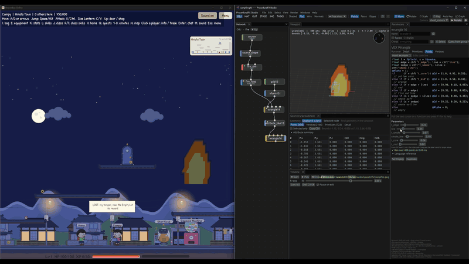

<p align="center"></p>

# ProceduralFX Studio

<a href="https://buymeacoffee.com/sangstari"></a>

A node-based procedural 3D tool for macOS, Windows and Linux. You build geometry
from networks of nodes, and the app includes:

- modelling nodes and VEX wrangles;
- volumes and OpenVDB;
- Pyro, FLIP, RBD and SOP solvers;
- a USD stage context;
- keyframe animation with a graph editor;
- rendering with [MoonRay](https://openmoonray.org).

Effects export as sprite sheets for [Bevy](https://bevy.org) games, and with **Keep updating**
ticked a running game picks up every change as you make it (with the free
[bevy_procedural_fx](https://crates.io/crates/bevy_procedural_fx) plugin):



Downloads are on the [Releases page](https://github.com/loksangho/proceduralfx-studio/releases/latest).

| Platform | Download | Requirements |
|---|---|---|
| macOS | [ProceduralFxStudio.dmg](https://github.com/loksangho/proceduralfx-studio/releases/latest/download/ProceduralFxStudio.dmg) | Apple Silicon Mac, macOS 14 or later |
| Linux | [ProceduralFxStudio-x86_64.flatpak](https://github.com/loksangho/proceduralfx-studio/releases/latest/download/ProceduralFxStudio-x86_64.flatpak) | x86_64 CPU with AVX2 (2013 or newer), Flatpak |
| Windows | [ProceduralFxStudio-windows-x64.zip](https://github.com/loksangho/proceduralfx-studio/releases/latest/download/ProceduralFxStudio-windows-x64.zip) | Windows 11 (x64) with virtualization turned on |

Once installed, the app checks for new versions at startup and offers to update
itself (**Help → Check for Updates…**). Windows 0.12.0 links to the new download
instead; from 0.13.0 Windows updates itself too.

## macOS

1. Download [ProceduralFxStudio.dmg](https://github.com/loksangho/proceduralfx-studio/releases/latest/download/ProceduralFxStudio.dmg) and open it.
2. Drag **ProceduralFX Studio** into **Applications**.
3. Open it from Applications.

The app is signed and notarized by Apple. The first time you open it, macOS
may ask you to confirm opening an app downloaded from the internet; click
**Open**. Run it from Applications rather than from the disk image, or it can't
update itself.

## Linux

The Linux build is a Flatpak bundle and runs on most distributions.

1. Install Flatpak if you don't have it ([setup guide for each distribution](https://flatpak.org/setup/)), then add Flathub:
   ```sh
   flatpak remote-add --user --if-not-exists flathub https://dl.flathub.org/repo/flathub.flatpakrepo
   ```
2. Download and install the app. The first install also downloads the GNOME runtime from Flathub, about 1 GB.
   ```sh
   curl -LO https://github.com/loksangho/proceduralfx-studio/releases/latest/download/ProceduralFxStudio-x86_64.flatpak
   flatpak install --user ./ProceduralFxStudio-x86_64.flatpak
   ```
3. Start it from your applications menu, or with:
   ```sh
   flatpak run com.loksangho.proceduralfxstudio
   ```

To uninstall: `flatpak uninstall --user com.loksangho.proceduralfxstudio`.

## Windows

1. Download [ProceduralFxStudio-windows-x64.zip](https://github.com/loksangho/proceduralfx-studio/releases/latest/download/ProceduralFxStudio-windows-x64.zip) and unzip it anywhere.
2. Run **ProceduralFX Studio.exe**. Keep the files in the folder together.
3. To render, choose **Render → Set Up Rendering on Windows…** once.

MoonRay is a Linux program, so on Windows it runs in a small Linux container
through WSL. The set-up window checks for WSL, then downloads MoonRay (about
1.3 GB, once). If WSL isn't installed, the window installs it: Windows asks an
administrator to approve that once, and a restart may be needed. Downloading
and rendering never need administrator rights.

## Effects in Bevy

**Render → Export Sprite Sheet…** renders the playback range with the real-time renderer
and packs it into one PNG, with a `.pfx.json` file describing the grid. The
[bevy_procedural_fx](bevy_procedural_fx) crate loads that as a Bevy asset and plays it:

```rust
commands.spawn(FxSprite::looping(assets.load("fx/fire.pfx.json")));
```

To start from something, **File → New from Preset** has five starter effects: Fire and
Smoke (loops), and Impact, Magic burst and Slash (one-shots). Each comes framed by its own
camera and set up for export. The AI assistant starts from them too, and changes them to fit
what you ask for. Tick **Seamless** under Loop to make a looping effect wrap without a jump.

Tick **Keep updating** when you export, and the app exports again whenever you change the
effect. A game running with Bevy's `file_watcher` feature shows each change within a moment.
If the game builds its effects into the program with `embedded_asset!`, use Bevy's
`embedded_watcher` feature instead.

https://github.com/user-attachments/assets/2fdcdd85-ec14-45ca-922b-c3bdfacd9b34

*Editing a fire in ProceduralFX Studio (left) while BeaverBoy Online, a Bevy game, picks
up each change (right).*

## Godot and Unity

Tick **Godot** or **Unity** under *Also for* in **Export Sprite Sheet…**, or pass `--godot`
or `--unity` to `proceduralfx_studio sprite-sheet`:

- **Godot 4**: `name.tres` beside the PNG is a `SpriteFrames` resource. Put it on an
  `AnimatedSprite2D` and it plays the sheet, looping, at its frame rate.
- **Unity**: `name.png.meta` makes Unity import the PNG already sliced into one sprite per
  frame (`name_0`, `name_1`…), uncompressed and at full size. Export into your project's
  `Assets` folder, then select the sprites and drag them into the scene to make an animation.

For particle systems, tick **Fill the grid** (`--fill-grid`): the sheet gets a grid with no
empty cells, since particle systems play every cell. With Godot ticked it also writes
`name_particles.tres`, a material for `GPUParticles2D`. In Unity, use the particle system's
Texture Sheet Animation in Grid mode with the sheet's columns and rows, or in Sprites mode
with the sliced sprites.

## Smooth playback with motion vectors

Tick **Motion vectors** in **Export Sprite Sheet…** (or pass `--motion-vectors`) and the
export also writes `name_motion.png`: how each pixel moves on its way to the next frame,
found from the rendered frames themselves. A game then slides each frame towards the next
instead of jumping or cross-fading, so a sheet with a quarter of the frames still plays
smoothly. It works best for smoke, explosions and anything that moves smoothly; fast,
scattered sparks need more frames.

- **Bevy**: `FxFlipbook` from [bevy_procedural_fx](bevy_procedural_fx) 0.3 plays it.
- **Godot 4** (with Godot ticked): `name_flipbook.tscn`, a Sprite2D with the shader set up.
- **Unity** (with Unity ticked): `name_flipbook.mat` and its shader, for a Quad, in URP or
  the built-in pipeline.

## Vertex animation (VAT) for 3D games

**Render → Export Vertex Animation…** bakes an object's motion over the playback range into
vertex animation textures, so a 3D game plays it on the GPU for the cost of a texture read or
two per vertex. (From the command line: `proceduralfx_studio vat scene.pfs out/name --godot --unity`.)
There are three kinds, and **Automatic** picks the one that suits the motion:

- **Soft**: points that stay the same and move freely: cloth, deformers, wobbling or twisting
  shapes. The textures hold each point's offset and normal.
- **Rigid**: pieces that move and turn without bending: destruction and RBD. The textures hold
  each piece's centre and rotation, so pieces stay perfectly rigid. Pieces come from the
  `piece` attribute (fracturing sets it) or from what's connected.
- **Fluid**: a mesh whose points and polygons change: liquids from Particle Fluid Surface,
  growing shapes. The textures hold every triangle corner's position and normal each frame.
  They get big, so keep the mesh's resolution modest.

To start from something, **File → New from Preset** has three made for it: **Flag** (a
soft loop), **Breaking wall** (rigid) and **Splash** (fluid, coarse enough to keep its textures
small).

You get `name.obj`, two EXR textures and `name.vat.json` describing the layout. Tick an engine
for what it needs:

- **Bevy**: nothing to tick. Put the files in your `assets` folder and spawn an `FxMesh` from
  [bevy_procedural_fx](bevy_procedural_fx) 0.2 with the `.vat.json` file. It plays in the main
  pass and in shadows, with culling bounds covering the whole animation:
  `commands.spawn(FxMesh::looping(assets.load("fx/wave.vat.json")));`

- **Godot 4**: `name_vat.tscn`, a ready scene: drag it into yours and it plays. It's a
  `MeshInstance3D` with `name.obj`, the material (`name_vat_material.tres` with
  `name_vat.gdshader`) and culling bounds covering the whole animation. Import settings keep the
  textures and mesh exact. Turn off the material's `use_time` and set `frame` to drive it
  from a script.
- **Unity (URP or the built-in pipeline)**: `name_vat.shader` and `name_vat.mat`, with import
  settings that keep the textures exact. Export into your `Assets` folder, put `name.obj` in the
  scene and give it the material. The project must use the Linear colour space (URP's
  default); in Gamma, the mesh shows magenta.

In Unity, if pieces or splashes fly far from where the first frame was, Unity may stop drawing
the mesh too early. The JSON's `bounds` give the whole animation's extent: set the renderer's
`Renderer.localBounds` to cover it.

## GIFs and movies

The flipbook viewer's **Save GIF…** saves a looping GIF over a dark background, ready to post.
**Save movie…** saves an MP4 (with [FFmpeg](https://ffmpeg.org) installed). From the command
line, `proceduralfx_studio animation scene.pfs fire.gif` (or `fire.mp4`) renders and saves one
in a single step.

## Support

ProceduralFX Studio is free. If it's useful to you, you can support its
development with a coffee: [buymeacoffee.com/sangstari](https://buymeacoffee.com/sangstari).

## Building from source

The app is written in Rust ([egui](https://github.com/emilk/egui)). A plain
build, without the OpenVDB, USD and MoonRay integrations, needs only a Rust
toolchain:

```sh
cargo run --release
```

The full builds include native OpenVDB and USD, plus a bundled MoonRay:

- **macOS:** `./proceduralfx_studio.sh package-macos` builds the app bundle in `dist/`.
- **Linux:** [packaging/linux](packaging/linux) contains the Flatpak manifest.
  [.github/workflows/flatpak.yml](.github/workflows/flatpak.yml) builds it on
  GitHub Actions, and publishes a release when a `v*` tag is pushed.
- **Windows:** you need Rust, Visual Studio 2022 with "Desktop development with C++",
  and CMake.
  1. Download `pfx-windows-deps.zip` from the
     [Windows libraries pre-release](https://github.com/loksangho/proceduralfx-studio/releases/tag/windows-deps-1e95e2a5cf14)
     and unzip it, for example to `C:\pfx-deps`. It holds OpenUSD, OpenVDB and Alembic,
     prebuilt with vcpkg. To build them yourself instead, run vcpkg on
     [packaging/windows/deps/vcpkg.json](packaging/windows/deps/vcpkg.json) with the
     `x64-windows-release` triplet. That takes a few hours.
  2. Build the app in PowerShell:
     ```powershell
     $env:USD_ROOT = "C:\pfx-deps"
     $env:OPENVDB_ROOT = "C:\pfx-deps"
     $env:ALEMBIC_ROOT = "C:\pfx-deps"
     cargo build --release --features native-usd,native-openvdb,native-alembic
     ```
  3. Copy `C:\pfx-deps\bin\*.dll`, and the `C:\pfx-deps\bin\usd` folder, next to
     `target\release\proceduralfx_studio.exe`, so the app finds the libraries and USD's
     plugins.
  4. Rendering with MoonRay goes through `pfx-render.exe`, which runs MoonRay in a WSL
     container. Build it from [packaging/windows/render](packaging/windows/render) with
     CMake and the `Microsoft.WSL.Containers` NuGet package, and put it beside the app
     with the package's `wslcsdk.dll`.
     Without it, everything except MoonRay rendering still works.

  [.github/workflows/windows.yml](.github/workflows/windows.yml) does all of this on
  GitHub Actions, and is the full recipe, including how the release zip is laid out.

## Our promise

These hold for everyone, free or paid, for the version you have, whatever changes later.
The full text is at [build3dstudio.com/promise](https://www.build3dstudio.com/promise).

1. **Your work is yours.** We claim no rights over anything you make.
2. **Your files stay open.** Scenes are plain text in a [documented format](docs/scene-format.md).
3. **Your license keeps working.** If you stop paying for a commercial license, you keep the last version you had, forever.
4. **The terms you get are the terms you keep.** We never change the license of a version you already have.
5. **We never train on your work.** Your scenes, prompts and outputs aren't used to train any AI model.
6. **Prices are always visible.** The AI assistant shows an estimate before you build and the cost after, in real money. Credit never expires.
7. **If we shut down, the tool lives on.** The code becomes open source under Apache-2.0. This is written into the [LICENSE](LICENSE).

## License

ProceduralFX Studio is **source-available** under the
[PolyForm Noncommercial License 1.0.0](https://polyformproject.org/licenses/noncommercial/1.0.0).
See [LICENSE](LICENSE).

**Free for noncommercial use, forever.** Learning, personal projects, hobby games,
research, and use by schools, charities and other noncommercial organizations
are all free. You can read, build, modify and share the code for those purposes.

**Commercial use needs a commercial license.** If you use ProceduralFX Studio
to make something you sell or earn money from (for example, effects for a
commercial game), please get a commercial license. Right now that's the
[Founder's license](https://www.build3dstudio.com/founder): A$49 once, for every
version, for the first 100 people. Questions: [support@build3dstudio.com](mailto:support@build3dstudio.com).

**If the project ends, it becomes open source.** The code is also licensed under
Apache-2.0 from the day the project is announced as discontinued, or after 18 months
in a row with no new version and no commercial licenses for sale. See LICENSE for
the exact terms.

---

Familiar if you've used Houdini. Houdini is a trademark of Side Effects Software Inc.
ProceduralFX Studio is not affiliated with or endorsed by SideFX.
