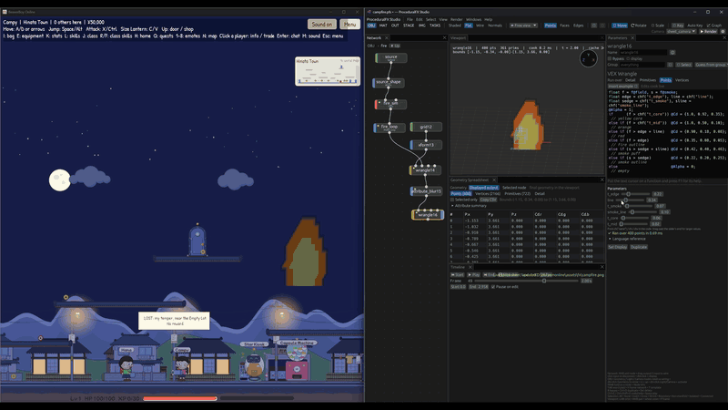

# bevy_procedural_fx

Play effects exported from [ProceduralFX Studio](https://github.com/loksangho/proceduralfx-studio) in [Bevy](https://bevy.org):
sprite sheets for 2D, and [vertex animation](#vertex-animation-for-3d) for 3D cloth,
destruction and liquids.



*Live: change the effect in ProceduralFX Studio and the running game picks up each export.*

Build an effect in ProceduralFX Studio, choose **Render → Export Sprite Sheet…**, and drop the
two files it writes into your game's `assets` folder:

- `fire.png`: the frames, packed in a grid, with a transparent background
- `fire.pfx.json`: the grid, frame count and frame rate

Then add the plugin and spawn an `FxSprite`:

```rust
use bevy::prelude::*;
use bevy_procedural_fx::{FxSprite, ProceduralFxPlugin};

fn main() {
    App::new()
        .add_plugins((DefaultPlugins, ProceduralFxPlugin))
        .add_systems(Startup, setup)
        .run();
}

fn setup(mut commands: Commands, assets: Res<AssetServer>) {
    commands.spawn(Camera2d);
    commands.spawn(FxSprite::looping(assets.load("fx/fire.pfx.json")));
}
```

## Playing effects

| | |
| --- | --- |
| `FxSprite::looping(sheet)` | Plays over and over, for fires, auras and ambient effects. |
| `FxSprite::once(sheet)` | Plays once and holds the last frame. |
| `FxSprite::one_shot(sheet)` | Plays once, then despawns the entity, for impacts and explosions. |
| `.with_speed(2.0)` | Plays at twice the exported frame rate. |

`FxSprite` adds a `Sprite`, so tint, flip and size it as usual, and place it with a
`Transform`. You can change `paused`, `speed` and `elapsed` while it plays.

The sprite's transform sits where the centre of the full rendered frame was, even when
the frames were cropped on export. An effect therefore lines up the same way however much
empty space was trimmed.

## Changing effects while the game runs

With Bevy's `file_watcher` feature on, exporting the sheet again to the same files
updates every sprite that uses it, without restarting the game. Tick **Keep updating** in
ProceduralFX Studio's Export Sprite Sheet window and it exports again whenever you change
the effect, so the game follows along as you work.

```toml
bevy = { version = "0.20", features = ["file_watcher"] }
```

If your game builds its effects into the program with `embedded_asset!`, for example for
phones or the web, turn on `embedded_watcher` instead. It watches the files the embedded
assets were built from, so export into that folder beside your source, such as `src/fx/`,
and run the game with `cargo run` from its project folder. Embed both files of each effect:

```rust
embedded_asset!(app, "fx/fire.pfx.json");
embedded_asset!(app, "fx/fire.png");
// Then load it from the embedded source:
commands.spawn(FxSprite::looping(assets.load("embedded://my_game/fx/fire.pfx.json")));
```

## Vertex animation for 3D

Simulations are too slow to run in a game, so you bake them. In ProceduralFX Studio,
**Render → Export Vertex Animation…** stores an object's motion in two textures. Put the
files it writes in your `assets` folder:

- `wave.obj`: the mesh
- `wave_offsets.exr` and `wave_normals.exr` (the names depend on the kind): the motion
- `wave.vat.json`: what kind of bake it is, and how the textures are laid out

Then spawn an `FxMesh` with the `.vat.json` file:

```rust
commands.spawn((
    FxMesh::looping(assets.load("fx/wave.vat.json")),
    Transform::from_xyz(0.0, 1.0, 0.0),
));
```

The entity gets a `Mesh3d` and a `VatMaterial`: a `StandardMaterial` whose vertex shader
moves the mesh on the GPU. It costs a texture read or two per vertex. The animation plays in
the main pass and in shadows, and in the depth, normal and motion-vector prepasses. All
three kinds of bake work:

- **Soft**: points that move freely, such as cloth, deformers, and wobbling or twisting
  shapes. Frames blend smoothly.
- **Rigid**: pieces that move and turn without bending, such as destruction. Pieces never
  warp.
- **Fluid**: a mesh whose points and polygons change every frame, such as a liquid. It
  shows whole frames.

`FxMesh` plays like `FxSprite`: `looping`, `once` and `one_shot` work the same, and so do
`with_speed`, `paused` and `elapsed`. To set the surface, pass a `StandardMaterial`:

```rust
FxMesh::one_shot(rubble).with_material(StandardMaterial {
    base_color: Color::srgb(0.8, 0.45, 0.3),
    perceptual_roughness: 0.8,
    ..default()
})
```

The material's textures can't use the mesh's UVs, because those pick each vertex's texels.
The mesh is culled by the bounds of the whole animation, so pieces that fly far stay
visible. Exporting again to the same files updates it live, as with sprite sheets.

Vertex animation needs the `vat` feature, which is on by default and brings in Bevy's
`bevy_pbr` and `exr` features. For a 2D-only game, turn it off:

```toml
bevy_procedural_fx = { version = "0.2", default-features = false }
```

## Examples

```sh
cargo run --example fire
cargo run --example vat
```

`fire` shows three fires from one sheet, playing at different speeds. Click to set off
one-shot bursts.

`vat` shows a rippling sheet (soft) beside a box that has broken apart (rigid). Press
Space to break another one.

## The file format

`.pfx.json` is plain JSON. Other engines can read it too:

| Field | Meaning |
| --- | --- |
| `format`, `version` | `"procedural-fx-sprite-sheet"`, `1` |
| `image` | The PNG's file name, relative to the JSON file |
| `frame_size` | Each frame's width and height in pixels |
| `columns`, `rows` | The grid, filled left to right, top to bottom |
| `frame_count`, `fps` | How many frames there are, and how fast they play |
| `frames` | Each frame's `[x, y, width, height]` in the PNG |
| `source_size`, `offset` | The size each frame was rendered at, and where the cropped frame's top-left corner was in it |

## Bevy versions

| bevy_procedural_fx | Bevy |
| --- | --- |
| 0.1, 0.2 | 0.20 |

## License

The plugin is MIT or Apache-2.0, at your option, the same as Bevy. ProceduralFX Studio
itself has [its own license](https://github.com/loksangho/proceduralfx-studio/blob/main/LICENSE).
Effects you make with it are yours.
